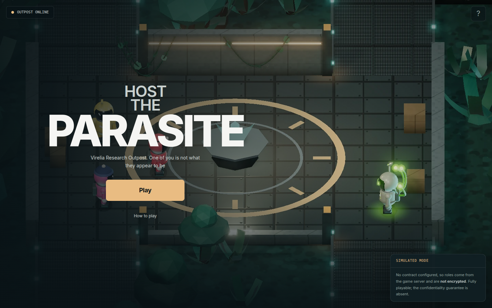
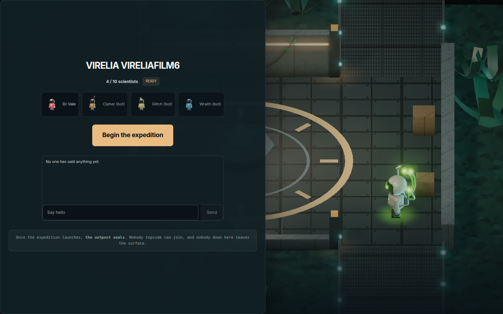
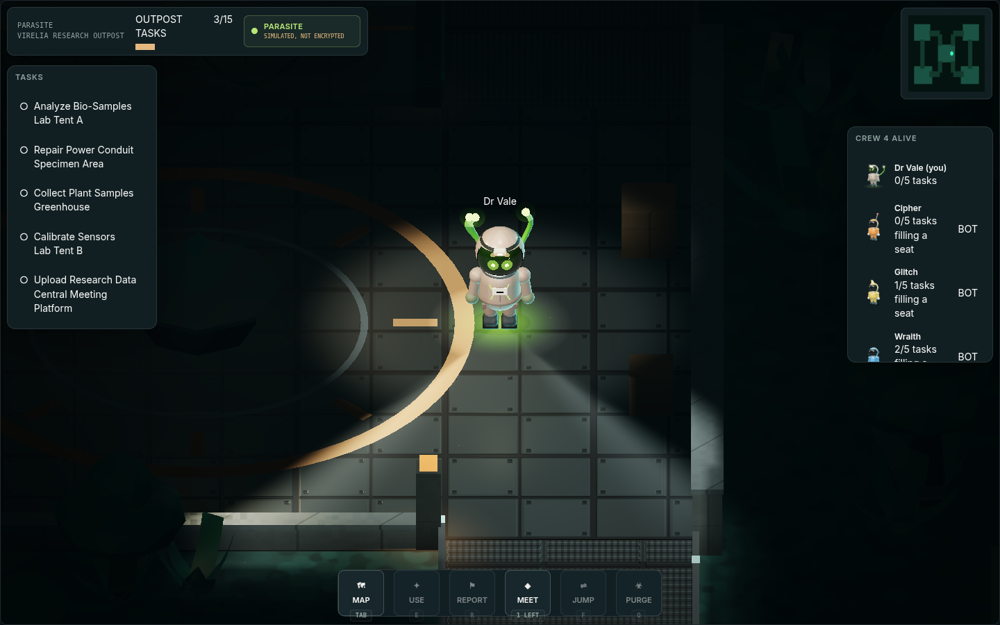
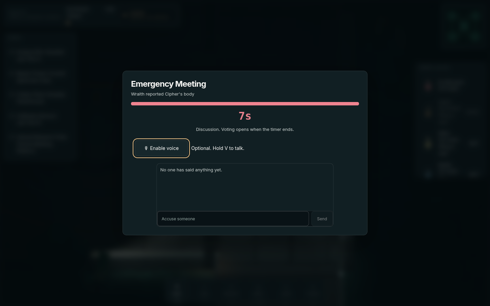
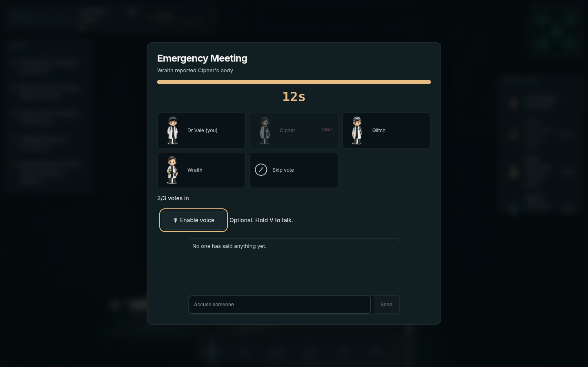
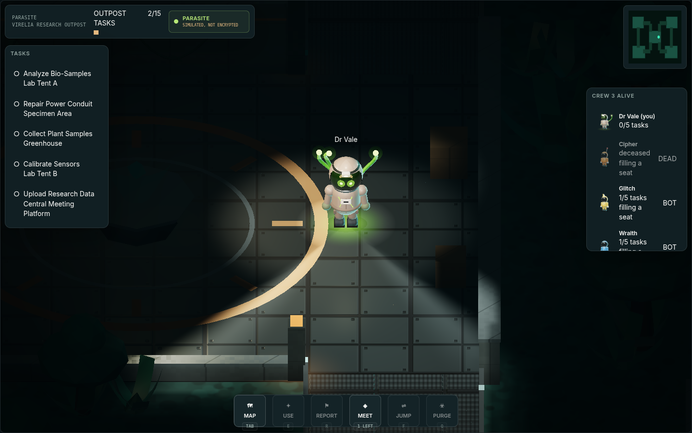
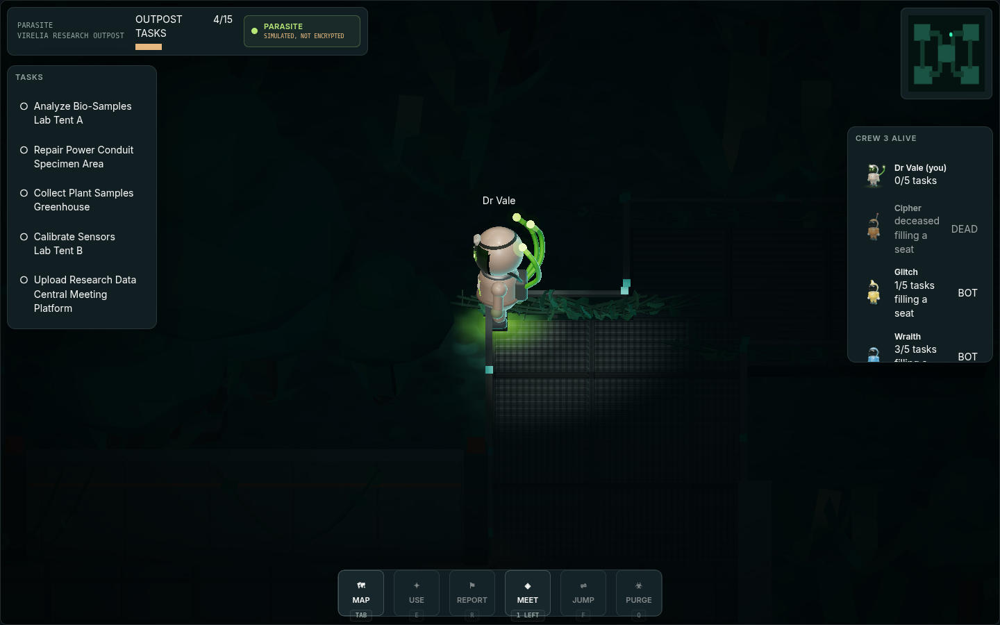
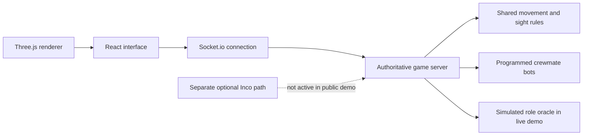

<div align="center">


# Parasite

**A social deduction game where the infection can change hosts.**

A crew of scientists, a jungle research outpost, and a teammate who may not stay human.

[Play the live demo](https://theparasite.xyz)


</div>

## Current release

The public release is a wallet-free browser demo with **simulated, server-managed roles, not encrypted gameplay**. It uses Three.js, not Phaser. Bots fill the initial solo crew, so one person can start a round. A separate Inco contract integration exists in the repository; this README does not claim that the live release uses it or that its confidentiality properties have been established by this submission.

## Contents

1. [The game](#the-game)
2. [A tour of the current build](#a-tour-of-the-current-build)
3. [How it is built](#how-it-is-built)
4. [Build and test](#build-and-test)
5. [AI contribution](#ai-contribution)
6. [Development plan](#development-plan)
7. [Verification and limits](#verification-and-limits)

## The game

The crew wins by completing research tasks or ejecting the Parasite. The Parasite hunts the crew and can transfer the infection to another living scientist. A player who was innocent earlier can become the threat later, while the previous host can genuinely become innocent.

Bodies trigger discussion and voting. Directional sight limits what a living scientist can see, and the server filters unseen positions rather than relying solely on a dark overlay.

## A tour of the current build

These are desktop captures from the public HTTPS game, made at 1440x900. The capture tools are `scripts/loadout-record.mjs` and `scripts/loadout-cdp-record.mjs`. Automated visual interpretation was quota-blocked, so these are not presented as an artistic approval.

### 1. Landing and mode disclosure

The opening menu introduces Virelia Research Outpost and offers **Play** and **How to play**. The mode card explicitly says that this build's roles are not encrypted. A visitor does not need a wallet to try it.


### 2. Room lobby and solo bots

Enter a name and outpost code to join the waiting room. The lobby shows the scientist roster and marks bots. **Begin the expedition** starts the match when enough seats are available.



### 3. Outpost and role reveal

The Three.js scene draws the scientists and outpost, while the surrounding interface shows tasks, crew and actions. Receiving the Parasite role triggers an explicit reveal. This image is from a separate real public round in which the recording player started as the Parasite.



### 4. Body report and discussion

A reported body interrupts exploration with a meeting. This capture records Wraith reporting Cipher's body in an unseeded public game with native bots. Discussion runs before voting opens.



### 5. Voting

During **Voting is open**, living scientists can choose another scientist or **Skip vote**. The interface shows which crew members remain and the number of votes cast. Bots participate through the actual server logic.



### 6. Meeting outcome

The meeting resolves before exploration resumes. This round produced **Nobody was ejected**, rather than a staged successful accusation. The game keeps uncertainty when the vote does not identify a target.



### 7. A changed infection host

After the meeting, the recording player's role changed from **HUMAN** to **PARASITE**. The task panel now explains that the new host's tasks are fake. This is a simulated-role transfer in the running game, not evidence of an on-chain encrypted Jump.



## How it is built



| Folder | Job |
| --- | --- |
| `packages/shared` | Wire types, movement, map and visibility rules |
| `packages/server` | Authoritative movement, tasks, meetings, bots and simulated roles |
| `packages/web` | Next.js/React interface and Three.js world |
| `packages/contracts` | Separate Solidity/Inco implementation and local contract tests |
| `docs/inco.md` | Reference for the optional private-role integration |

The deployed frontend is a static export served by nginx. Socket.io connects it to the multiplayer backend. No Next.js server is needed for that static release. Production capacity is deliberately capped at four rooms and 24 proxied connections.

## Build and test

Requires Node.js 20 or later. From the repository root:

```bash
npm ci
npm run build
npm run typecheck
npm test
```

The launch tree contains the static-export configuration. To preview its static output, serve `packages/web/out` with a static file server and run `packages/server/dist/index.js` separately with the socket endpoint configured for your preview. Do not reuse production ports or assume the browser's endpoint is dynamically replaced after building.

To regenerate submission captures against the live demo, the recording scripts need Puppeteer, the installed Chromium executable and ffmpeg. The CDP recorder writes JPEG frames with their actual capture timestamps, preserving the timing of the observed game rather than inventing smooth motion between images.

## AI contribution

AI assisted development of procedural 3D assets and rendering, React interfaces, server and bot iteration, regression tests, browser automation, performance investigation and documentation. The bots themselves use programmed rules, not live LLM inference. Product decisions and final submission responsibility remain with the builder.

## Development plan

1. Structured human playtests, core-loop balance, reconnect handling and real-phone performance measurement.
2. Public matchmaking, stronger solo practice, touch controls and quality presets.
3. Reproducible end-to-end testnet verification of the separate Inco integration before making encryption claims.
4. Later: optional over-the-shoulder third-person v3, more maps and ranked play if player demand supports them.

Mainnet is a future decision requiring security review and cost approval. No roadmap item above is represented as shipped.

## Verification and limits

| Check | Evidence and scope |
| --- | --- |
| Launch regression suite | Launch log records 192 passing tests; not rerun by this documentation pass |
| Endurance | Launch log records 600 seconds of automated socket play and six completed rounds; not a human-device GPU benchmark |
| Public browser recording | Actual HTTPS game, bot body report, discussion, voting, no-ejection result and later role change |
| Media | 90.15-second silent H.264 capture, 1280x800, 20 fps container; source capture cadence is low |
| Confidentiality | Public roles are simulated and trusted to the server |
| Visual review | Automated image review unavailable due quota; normal-device playback and aesthetics remain unapproved |
| Submission | X posting and form submission remain with the builder because account authentication and form access are unavailable here |

See [release notes](docs/release.md) for the published build's checks and limitations.
